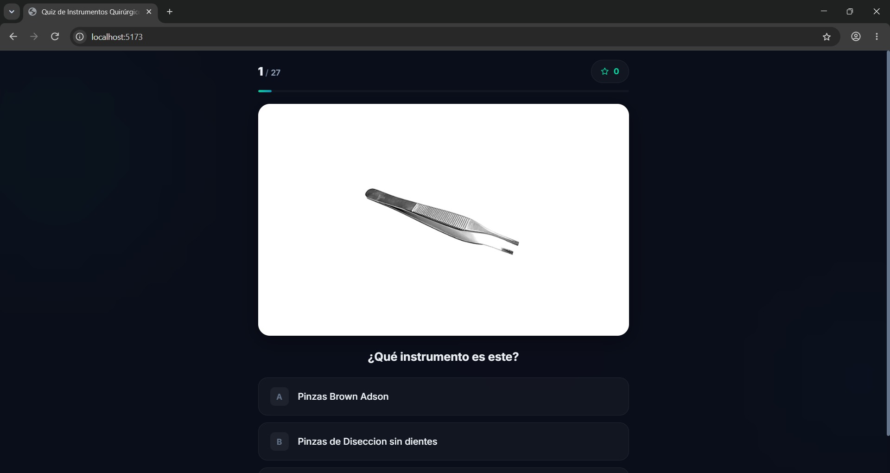

# 🏥 Quiz de Instrumental Quirúrgico

Una aplicación web interactiva diseñada para estudiantes de medicina, enfermería quirúrgica y profesionales de la salud, orientada a evaluar y fortalecer el reconocimiento visual de instrumental quirúrgico de uso común en quirófano.

---

## ✨ Características

- 🩺 **27 Instrumentos Quirúrgicos Reales**: Fotografías de alta fidelidad organizadas por especialidad y tiempo quirúrgico (hemostasia, disección, corte, separación, etc.).
- 🔀 **Aleatorización Completa**: Algoritmo Fisher-Yates para barajar tanto el orden de las preguntas como las opciones en cada intento.
- ⚡ **Retroalimentación Inmediata**: Indicación visual instantánea de acierto o error con explicación de la respuesta correcta.
- 📊 **Pantalla de Resultados y Resumen**:
  - Puntuación total y porcentaje de acierto.
  - Escala de calificación cualitativa (Excelente, Muy Bien, Regular, Requiere Práctica).
  - Revisión detallada pregunta por pregunta comparando tu respuesta con la correcta.
  - Animación de confeti para puntuaciones destacadas (≥ 70%).
- 🎨 **Diseño Moderno y Responsivo**:
  - Estética *dark mode* médica con efectos de *glassmorphism* y orbes ambientales.
  - Visor de imágenes optimizado para contraste y nitidez de detalles metálicos.
  - Totalmente adaptable a dispositivos móviles, tablets y escritorios.

---

## 🖼️ Screenshots

---

## 🛠️ Tecnologías

- **React 19**: Biblioteca frontend para interfaz declarativa y componentes modulares.
- **Vite 8**: Herramienta de compilación ultrarrápida y servidor de desarrollo.
- **Vanilla CSS (Design Tokens)**: Sistema de diseño personalizado con variables CSS, animaciones fluidas y sin dependencias pesadas de frameworks UI.
- **Oxlint**: Linter de alto rendimiento para asegurar calidad de código.

---

## 📋 Catálogo de Instrumentos Incluidos

| # | Instrumento | Tipo / Uso habitual |
|---|-------------|---------------------|
| 1 | Charola de Mayo | Soporte de instrumental estéril de uso inmediato |
| 2 | Valva Suprapúbica (Doyen) | Separación profunda de pared abdominal/pelvis |
| 3 | Pinzas Forester / Anillo | Asepsia, sujeción de gasas o manipulación de vísceras |
| 4 | Pinzas Babcock | Sujeción atraumática de vísceras tubulares (apéndice, trompas) |
| 5 | Tijeras Metzenbaum | Corte fino y disección de tejidos blandos |
| 6 | Pinzas Kelly | Hemostasia de vasos medianos |
| 7 | Pinzas Rochester Ochsner | Prensión fuerte y hemostasia con dientes distales |
| 8 | Pinzas Allis | Prensión y tracción de planos fasciales o bordes |
| 9 | Cánula de Aspiración Yankauer | Aspiración de fluidos en cavidad general |
| 10 | Mango de Bisturí | Portacuchillas para incisión quirúrgica |
| 11 | Separadores Farabeuf | Separación manual superficial de planos |
| 12 | Pinzas de Disección con dientes | Prensión firme de tejidos resistentes (piel, aponeurosis) |
| 13 | Pinzas de Disección sin dientes | Prensión delicada de tejidos y vísceras |
| 14 | Separadores Army | Separación manual en planos intermedios |
| 15 | Aspirador Poole | Aspiración abdominal profunda sin oclusión por epiplón |
| 16 | Pinzas Kelly Hemostáticas | Control de hemorragia por pinzamiento vascular |
| 17 | Porta Agujas Hegar | Sostén y manipulación de agujas quirúrgicas para sutura |
| 18 | Separadores Farabeuf | Exposición y tracción de tejidos superficiales |
| 19 | Pinzas Brown-Adson | Disección fina con múltiples microdientes |
| 20 | Tijeras Mayo | Corte de material quirúrgico (suturas, gasas) y tejidos densos |
| 21 | Tijeras Metzenbaum | Disección tisular precisa en planos profundos |
| 22 | Gasas con Trama | Elemento de absorción radiopaco para control de fluidos |
| 23 | Lápiz de Electrocauterio | Corte y electrocoagulación tisular mediante RF |
| 24 | Tijeras Onfalótomo | Corte del cordón umbilical en procedimientos obstétricos |
| 25 | Compresas de Vientre | Protección de vísceras y hemostasia por compresión |
| 26 | Pinzas Umbilicales | Oclusión y pinzamiento del cordón umbilical |
| 27 | Histerómetro | Medición de la profundidad de la cavidad uterina |

---

